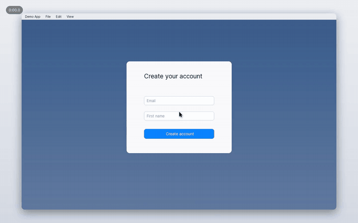

# proofreel

Review proof for computer-use agents. proofreel records an agent as it drives a real screen, then makes a short
review video and a page that a person can check in a minute.

- **The video looks edited, but no one edits it.** A drawn pointer glides to each click on a slight arc. Each click
  presses and sends out a ring. The camera zooms in before each action, pans to the next one when it is near, and
  zooms out when the work moves on. Each step is a caption, and each action and check is a chip. Time with no
  change on the screen plays at up to 8x, with a smooth ramp in and out.
- **The video fits about 30 s.** Busy time plays at up to 2.5x when the session is long, a wait for the screen plays
  at 3x, and a badge shows the speed whenever it is above 1x.
- **The page is the review.** It has the video, a scrub bar with a mark for each step and check, and the list of
  actions with thumbnails. A click on a row jumps the video to that moment. A failed check marks the page *Problem*.
- **Saved states for VMs.** Save a VM as a named state, such as `clean-os`, `app-installed`, or
  `signed-in-mid-onboarding`. Then start each test from that state in seconds. A warm state keeps the memory, so the
  test starts with the apps already open. A state that a flow makes records the flow, so you can make it again when
  the app changes. macOS and Linux guests run in Tart; Windows 11 ARM and Linux guests run in QEMU.
- **Any VNC screen.** This includes macOS and Linux VMs in Tart or UTM, QEMU, and Docker desktops with x11vnc.
  Another tool can also make the frames: give proofreel a folder of timestamped screenshots and an event log.



```bash
pip install git+https://github.com/YGao2005/proofreel   # Python 3.11+, and ffmpeg on PATH
proofreel demo               # a made-up session, no VNC needed: open the index.html it prints
```

## Record a session

```bash
export PROOFREEL_VNC=127.0.0.1::5900 PROOFREEL_PASSWORD=...   # or: proofreel vm up <state>
proofreel start sign-up --title "Sign up" --about "A new user makes an account."
proofreel step "Fill in the form"
proofreel click-text "Email"                 # finds the words on the screen, then clicks them
proofreel type "sam@example.com"
proofreel key tab
proofreel click 1210 830 --label 'click "Create account"'
proofreel wait-text "Welcome" 30
proofreel check text "Welcome, Sam"          # a pass or fail on the page
proofreel check cmd "curl -sf localhost:8080/health" --label "The server is up"
proofreel stop                               # makes session.mp4, index.html, poster.jpg, shots/
```

Each command is one action, so an agent can drive the screen with the commands alone. To find words on the screen,
proofreel uses Apple Vision on macOS hosts and Tesseract on other hosts.

### Review on claude.ai

`proofreel publish <session> --out <review folder>` adds a run to a review folder: one page that holds every run of
one journey, so the link in a pull request never changes. It prints the files of the new run and the page's runtime
capabilities. Claude then publishes the page as a claude.ai Artifact (the same file path or URL each time). On
claude.ai the page also has:

- **Comment** on any step: the comment pins to that step.
- **Send to Claude** on any step: the note goes to the Claude session that published the page, which can fix the
  problem, run the flow again, and publish the next run to the same page.
- **Review**: Approve or Needs work for each run, kept in the page's database, so Claude can read the verdict.
- **Ask about this moment**: Claude answers a question from the current video frame and the run's log.

Opened as a plain file, the page is a static review page.

### Flows

A flow is a text file with one proofreel command on each line. Use `#` for comments, and `${NAME}` or
`${NAME:-default}` for values that you set with `--set NAME=value`. A failed `check` is recorded, and the flow
continues. Any other failure stops the flow, and the page shows where it stopped.

```bash
proofreel run flows/sign-up.flow --set EMAIL=sam@example.com
```

### When another tool drives the screen

Log what the other tool does, and proofreel records and renders it in the same way:

```bash
proofreel event click 'click "Save"' --x 640 --y 410
proofreel event check "The file is saved" --ok
```

## VM states

### macOS and Linux (Tart)

```bash
proofreel vm base macos-26 ghcr.io/cirruslabs/macos-tahoe-vanilla:26.0   # once: a clean OS
proofreel vm up macos-26 --warmable           # a throwaway run VM, cloned in seconds
proofreel vm put MyApp.dmg /Users/admin/Downloads/
# ... install the app, stop before any permission prompt ...
proofreel vm save app-installed               # cold: the disk only
# ... go on through onboarding to the step you want ...
proofreel vm save mid-onboarding --warm       # warm: the memory too, so the app is still open
proofreel vm states
#   macos-26        2026-11-18 20:10
#     app-installed 2026-11-18 20:25
#       mid-onboarding 2026-11-18 20:31  [warm]
proofreel vm up mid-onboarding                # each test starts here
proofreel vm build app-installed --from macos-26 --flow flows/install.flow --set DMG=MyApp-1.2.dmg
proofreel vm down
```

A clone is copy on write (APFS), so a state costs only the disk blocks that it changes. On an M-series Mac with a
macOS 26 guest: `up` from a cold state takes about 18 s to SSH ready, a warm `up` about 12 s with the apps as they
were, and `save --warm` about 60 s. A warm state needs a run VM
that was started with `--warmable`. Tart then turns off the VM's audio devices, so do not test a microphone in a
warm VM.

### Windows 11 ARM and Linux (QEMU)

```bash
brew install qemu
proofreel vm base win11 win11.qcow2 --backend qemu      # once: a disk that boots Windows (see below)
proofreel vm up win11                                   # PowerShell over SSH, the screen over VNC
proofreel vm sh 'Get-ComputerInfo -Property OsName'
proofreel vm sh 'schtasks /create /tn open /tr notepad.exe /sc once /st 00:00 /it /f; schtasks /run /tn open'
proofreel vm save notepad-open --warm                   # the memory too: Notepad stays open
proofreel vm up notepad-open
```

`base` takes a disk file: a qcow2 (cloned, copy on write) or any format that `qemu-img` reads (converted). All the
other `vm` commands work as they do for Tart, and `--warmable` is not necessary. A Windows disk must have:

- Windows 11 ARM64 that starts from UEFI on an NVMe disk (the Windows boot manager on the EFI partition).
- The virtio network driver (NetKVM, ARM64, from [virtio-win](https://github.com/virtio-win/virtio-win-pkg-scripts)).
- OpenSSH Server that starts automatically, with password login and PowerShell as its default shell
  (`HKLM\SOFTWARE\OpenSSH\DefaultShell`).
- Automatic sign-in for the user that you give to `base` (`--user`, `--guest-password`; the default is admin/admin),
  hibernation off (`powercfg /hibernate off`), and no sleep or lock screen.

UTM's Windows VMs meet these when you install OpenSSH: use the `.qcow2` in the bundle's `Data` folder.

proofreel runs `qemu-system-aarch64` with HVF, headless (`-display none`, `-audio none`, no sound device, no
clipboard), QEMU's own VNC server on 127.0.0.1, user networking with SSH forwarded from a free 127.0.0.1 port, an
NVMe disk, a USB keyboard and tablet, and a `ramfb` screen. A state is a folder in `~/.proofreel/qemu`: `disk.qcow2`,
`vars.fd` (the UEFI variables), and for a warm state `memory.bin`. A cold save shuts the guest down with the ACPI
power button. A warm save pauses the VM and writes its memory and device state to `memory.bin` (a QEMU migration
to a file); `up` loads it with `-incoming`. This works with the UEFI variables as a raw flash file. QEMU's own
`savevm` does not: with raw variables it stops with "Device 'pflash1' is writable but does not support snapshots".
With the variables as a qcow2, `savevm` works but writes the memory into the variables file, `-loadvm` at start
works, and `loadvm` in a running VM stops QEMU 11.1 with an assertion.

WINDOWS_TIMES

## The session folder

Any tool can write this folder and then run `proofreel render <dir>`:

| File | Content |
|---|---|
| `session.json` | `{"title", "about", "meta": {label: value}, "error"}` |
| `events.jsonl` | one action on each line: `{"t": unix seconds, "kind", "text", "x", "y", "ok", "detail"}`. The kinds are `step`, `note`, `click`, `double`, `right`, `move`, `drag` (`x2`, `y2`), `type`, `key`, `open`, `wait`, and `check` |
| `frames/*.jpg` | the screen, in name order |
| `times.txt` | the unix time of each frame, one on each line |
| `screen.txt` | `<width> <height>`: the pixel space of the event coordinates (the frames can be smaller) |

## How it works

- **Capture** (`capture.py`): the recorder gets full VNC frames as fast as the screen changes (up to 24 a second),
  makes them half size, and saves them as JPEG on two threads. Some VNC servers send nothing while the screen stays
  the same. Apple Virtualization (Tart and UTM macOS guests) is one of these. For these servers, a request that
  waits 1 s reconnects, because a new connection always gets a whole frame.
- **Time** (`motion.timeline`): the renderer finds the moments when the screen changes (a 96x64 difference) or an
  action occurs. These moments play at 1x, and the time between them plays at up to 8x. The speed ramps, so the
  video has no cuts.
- **Camera** (`motion.Camera`): actions that are near in time and space form a group. In a group, the camera zooms
  in once and pans from action to action. A critically damped spring moves the camera, so it never jumps or
  overshoots.
- **Drawing** (`draw.py`): the renderer draws shapes at 4x and then scales them down, because Pillow draws without
  antialiasing. It renders the frames in parallel and sends them to ffmpeg (H.264, CRF 28).

## Limits

- A run VM is headless and isolated: no window, no audio device (Tart `--no-audio`, QEMU `-audio none` and no
  sound device), no shared clipboard. Nothing it does shows or plays on the host.
- One run VM at a time for each `PROOFREEL_VM` name. macOS lets a Mac run at most 2 macOS VMs at once.
- A VNC server sends keys as keysyms. Some apps read hardware key codes or modifier-only keys, such as a key that
  you hold down. Send those keys from in the guest instead, and log them with `proofreel event key ...`.

## License

[PolyForm Noncommercial 1.0.0](LICENSE): free to use, change, and share for any noncommercial purpose (personal
projects, research, education, nonprofits). For commercial use, ask the author.
