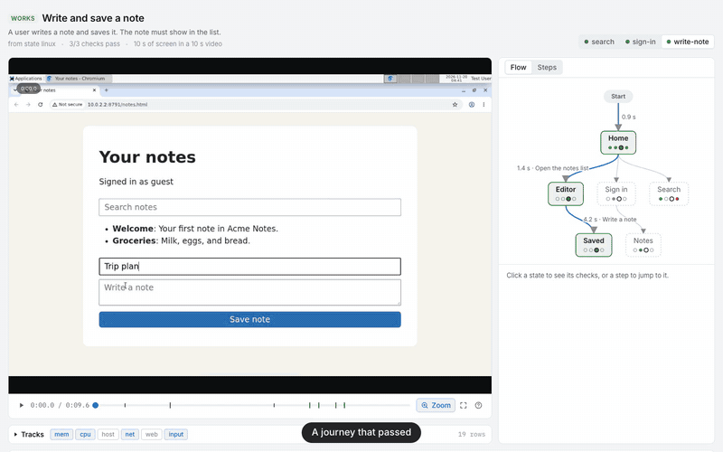

# proofreel

Video proof that your coding agent's change works. proofreel lets Claude Code drive your app in a clean VM as a user
would, record it, and publish a review page that a person can check in a minute.

**[See a real review page →](https://claude.ai/artifact/PeehtyBLEMVUsxokb5FqbT)** (the Acme Notes example: three
journeys that pass and one with a failed network budget)

[](https://raw.githubusercontent.com/YGao2005/proofreel/main/docs/tour.mp4)

## Install

```bash
pip install "proofreel[network,browser]"   # Python 3.11+, on an Apple Silicon Mac
proofreel demo               # a made-up session, no VM needed: open the index.html it prints
```

Install the tools for the guests you use:

- `brew install ffmpeg`: always. It makes the video.
- `brew install qemu`: for a Linux or Windows guest (QEMU).
- `brew install cirruslabs/cli/tart`: for a macOS guest (Tart).

The `network` and `browser` extras add the network and browser probes that the Acme Notes budgets use.

To let Claude Code drive it, add the plugin in Claude Code:

```text
/plugin marketplace add YGao2005/proofreel
/plugin install proofreel@proofreel
```

## Quickstart

Make the `linux` state once. It downloads Debian (about 0.4 GB), installs Xfce and Chromium, and saves the disk. It takes
about 5 minutes and needs QEMU. A state that exists is not made again; `proofreel vm drop linux` removes it.

```bash
proofreel vm image                           # once: the linux state (Debian, Xfce, Chromium)
```

Then start a VM from the state, record a session, and publish the review page. The example app is in this repo:

```bash
git clone https://github.com/YGao2005/proofreel && cd proofreel
python3 examples/acme-notes/server.py &      # a made-up app on port 8791
proofreel vm up linux                        # a run VM, cloned from a saved state in seconds
proofreel start sign-in --title "Sign in" --about "A returning user signs in."
proofreel step "Open Acme Notes"
proofreel vm sh 'browse http://10.0.2.2:8791/'    # open a page in Chromium on the screen
proofreel wait-text "Welcome back" 30
proofreel click-text "Email"                 # finds the words on the screen, then clicks them
proofreel type "sam@example.com"
proofreel key tab
proofreel click-text "Sign in"
proofreel wait-text "Your notes" 20
proofreel check text "Signed in as sam@example.com"   # a pass or fail on the page
proofreel stop                               # makes session.mp4, index.html, poster.jpg, shots/
proofreel publish <session> --out review-sign-in   # adds the run to a review folder, and prints its files
proofreel vm down
```

`stop` prints the session folder to give to `publish`. `proofreel click 512 400` clicks a point on the screen.

Publishing is in [the review page](docs/review-page.md). To use an existing VNC screen in place of a VM, set
`PROOFREEL_VNC=127.0.0.1::5900` and `PROOFREEL_PASSWORD=...`.

A flow is a text file with one command on each line, so a journey runs again the same way. Write each line without the
word `proofreel`, and write `vm sh 'browse URL'` for the page step. [`examples/acme-notes/flows`](examples/acme-notes/flows)
has flows to copy. A suite runs many flows, each from a clean VM:

```bash
proofreel run flows/sign-up.flow --set EMAIL=sam@example.com
proofreel suite flows/ --out review-sign-in --title "Sign in"
```

## Checks

| Check | Passes when |
|---|---|
| `check text <text> [seconds] [--in BOX]` | the words show on the screen in the seconds (default 10) |
| `check no-text <text> [seconds]` | the words are gone from the screen in the seconds (default 0) |
| `check cmd "<command>" [seconds]` | a shell command on the host exits 0. It runs again each second until it does or the seconds pass |
| `check sh "<command>" [seconds]` | the same, but in the run VM over SSH (PowerShell on Windows) |
| `check running <process>` | a process with this exact name runs in the run VM |
| `check metric <series> <stat> --below N` (or `--above N`) | a budget on what a probe measured; see [Probes and budgets](docs/probes.md) |

`--in`, `click-text`, and the other commands are in [Flows, checks, and commands](docs/flows.md).

## The review page

On a wide screen the video, a scrub bar with a mark for each step and check, and a folded Tracks row are on the left.
The right column shows the state machine of the review folder, drawn from the runs' `state` lines (Flow), or a list of
the steps of each state with their times (Steps). A click on a state or a step jumps the video to that moment. The page
fits the window, and only that column scrolls. Journeys, Stats, and Network are tabs below. A failed check marks the
page *Fail*, and under the title a line names the first failure; a click on it jumps the video there. Approve and Needs work sit by the title.
Keys: Space plays, the arrows seek, J and K step, N finds the next failure.

Publishing, review folders, and what the page adds on claude.ai are in [the review page](docs/review-page.md).
Tracks, Stats, and Network show what the [probes](docs/probes.md) measured.

## Example: Acme Notes

[`examples/acme-notes`](examples/acme-notes) is a made-up notes app with three flows (sign in, write a note,
search). Its README says how to run it, and how `BROKEN=1` makes a run fail. The suite:

```bash
python3 examples/acme-notes/server.py &    # skip if it already runs
proofreel suite examples/acme-notes/flows --out review-acme
```

The tour above is made from these runs. `tools/readme_media.py review-acme` makes it again.

## Docs

| Page | What is in it |
|---|---|
| [Flows, checks, and commands](docs/flows.md) | the checks, flows, suites, states, crash reports, another tool that drives the screen, the accessibility tree, modifier keys |
| [VM states](docs/vm-states.md) | saved states, Tart (macOS and Linux), conditions, QEMU (Windows and Linux), the `linux` browser image |
| [Probes and budgets](docs/probes.md) | what a probe measures, `check metric`, `stats`, input latency, network requests, the probe contract |
| [The review page](docs/review-page.md) | what the page shows, publishing, review folders, claude.ai features |
| [How it works](docs/how-it-works.md) | the video, the screens it can record, the session folder, capture, time, camera, drawing |

The skill an agent reads is [`skills/proofreel/SKILL.md`](skills/proofreel/SKILL.md).

## Limits

- A run VM is headless and isolated: no window, no host audio (Tart `--no-audio`; QEMU `-audio none` and no
  sound device), no shared clipboard. Nothing it does shows or plays on the host.
- One run VM and one recording at a time for each `PROOFREEL_VM` name (default `pr-run`). Agents that work at the
  same time each set their own name, such as `PROOFREEL_VM=pr-a`. macOS lets a Mac run at most 2 macOS VMs at once.
  State and run names use letters, digits, `-`, and `_`. The backend names a run VM `<name>.vm`, so it never has the
  name of a state. Commands to one run VM share one SSH connection for each boot.
- Files go to `PROOFREEL_HOME` (default `~/.proofreel`): states, run records, compiled helpers, and `sessions/`
  (`PROOFREEL_SESSIONS`). The guest password is in each state's file (`states/<name>.json`), and it reaches `ssh` through the environment,
  never a command line. Use a throwaway password in a VM, never a real one.
- A VNC server sends keys as keysyms. Some apps read hardware key codes. A macOS run VM posts modifiers in the
  guest (see [Modifier keys](docs/flows.md#modifier-keys-macos-guests)); send other keys from in the guest, and log them with
  `proofreel event key ...`.

## License

[MIT](LICENSE).
