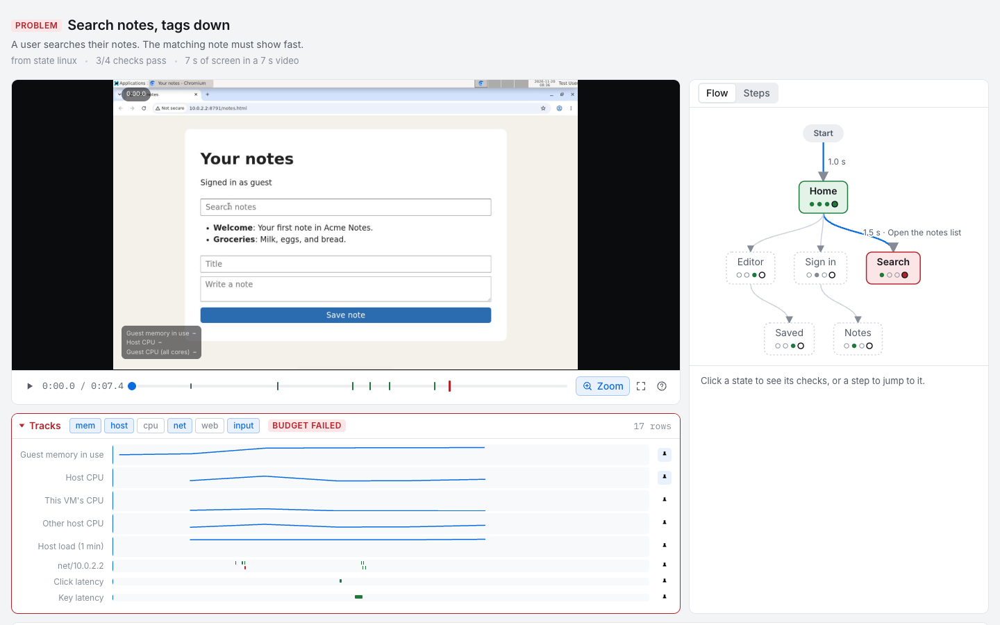

# The review page

One page holds every run of one journey. On a wide screen:

- **Left:** the video, a scrub bar with a mark for each step and check, and a folded Tracks row.
- **Right:** the state machine of the review folder, drawn from the runs' `state` lines (Flow), or the steps of each
  state with their times (Steps). A click on a state or a step jumps the video to that moment. Only this column scrolls.
- **Below:** the Journeys, Stats, and Network tabs. Tracks, Stats, and Network show what the [probes](probes.md)
  measured.

A failed check marks the page *Fail*. A line under the title names the first failure, and a click on it jumps the video
there. Keys: Space plays, the arrows seek, J and K step, N finds the next failure.

## Review inbox

`proofreel inbox add <review folder>` puts the page in a local inbox, and `proofreel inbox wait <id>` returns the
decision to the agent. See [Review inbox](inbox.md).

## Review on claude.ai

`proofreel publish <session> --out <review folder>` adds a run to a review folder: one page that holds every run of
one journey, so the link in a pull request never changes. It prints every file that the page uses (`files`, for all
the runs in the folder), the files of the new run (`new`), and the page's runtime capabilities. Claude then publishes the page as a claude.ai Artifact (the same file path or URL each time). On
claude.ai the page also has:

- **Comments** on any step or moment, through the artifact's own comments, which can go to the Claude session that
  published the page.
- **Review**: Approve or Needs work for each run, kept in the page's database, so Claude can read the verdict.
- **Ask about this moment**: Claude answers a question from the current video frame and the run's log.

Opened as a plain file, the page is a static review page.

The review folder keeps `runs.json` (`{"version": 2, "runs": [...]}`). It is the only copy of old runs, because
`clean` deletes sessions after 7 days. A folder that an older proofreel wrote is upgraded when you publish to it, and
its old file is kept as `runs.v1.json`. Publishing locks the folder and writes each file whole, so two agents can
publish to one folder at once.
